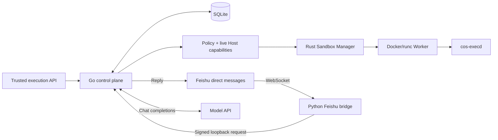

# super-agent-bot-plantform

**English** | [简体中文](README.zh-CN.md)

A persistent Agent control plane with disposable, policy-selected execution runtimes.
Built with Go, Rust and the C11 [light-agent](https://github.com/LeonQin-ai/light-agent) runtime.

Agent identity, task state and memory references persist independently of execution
processes. The current working path runs approved internal commands in hardened
Docker/runc Workers. Firecracker, gVisor and WASM have separate implementation and
validation milestones.

**Status:** Live Feishu replies and on-demand Docker execution have been verified
on a Linux VM. With the Cognitive OS Worker configured, both API messages and
Feishu direct messages run through the C11 Agent. Runtime wake and sleep endpoints
still require a separate lifecycle driver.

## What works today

| Area | Current behavior |
|---|---|
| Control plane | Go HTTP API; SQLite Agent, task, inbox and runtime records |
| Trusted execution | Synchronous and durable queued Docker commands; task status, idempotency and running cancellation |
| Recovery | Persist Worker handles before start; clean recorded Workers on restart; fail interrupted work without replay |
| Host capabilities | Authenticated probes; 30s refresh, 90s expiry, SQLite observation versions; failures disable execution |
| Docker Workers | Immutable preloaded image digest/ID; non-root, read-only rootfs, no network/capabilities, resource limits and private workspace |
| Feishu | WebSocket bridge, allowlisted direct messages, durable deduplication, on-demand Agent creation and model replies |
| Agent lifecycle | Generation fencing and wake/sleep state machine; production driver not wired |
| Firecracker / file broker | Jailer, vsock, Guest RPC and conflict-checked workspace foundations; KVM boot validation pending |
| gVisor / WASM | Policy and capability scaffolding; execution providers pending |

The Go scheduler currently executes Docker work only. A policy decision selecting
another backend does not make its provider available. See the [roadmap](docs/roadmap.md).

## Architecture



- **Go control plane** owns admission, durable state, cancellation and recovery.
- **Rust `cos-sandboxd`** is the trusted Host broker for Worker lifecycle and
  capability probing. Agents never receive its Docker socket or Host API token.
- **Rust `cos-execd`** runs structured commands inside the Worker with deadlines,
  bounded output, seccomp and resource limits.
- **Cognitive OS** supplies the reasoning/runtime foundation, pinned in
  [`COGNITIVE_OS_REF`](COGNITIVE_OS_REF). Direct container capacity tests are separate
  from the unfinished production message driver.

## Quick start

### Run the control plane

Requires Go 1.23+. Real Worker execution also needs a Linux Host Sandbox Manager,
Docker/runc and cgroup v2. Rust builds were verified with Rust 1.99.1.

```bash
git clone https://github.com/LeonQin-ai/super-agent-bot-plantform.git
cd super-agent-bot-plantform
go mod download
go run ./control/cmd/light-agentd
```

In another terminal:

```bash
curl -fsS http://127.0.0.1:8080/healthz
```

The default listener is `127.0.0.1:8080`; state is in `./data/light-agent.db`.
Configuration comes from environment variables; the process does **not** automatically
load `.env`. See [`.env.example`](.env.example).

Set `LIGHT_AGENT_API_TOKEN` before exposing the API beyond loopback. Authenticated
`/v1/*` requests use `Authorization: Bearer <token>`. Health and the Feishu webhook
have separate access rules.

### Enable real Docker execution

Follow the [Docker provider guide](docs/docker-provider.md) to build/preload an
immutable Worker image and start the trusted Host Sandbox Manager. Then configure:

```bash
export LIGHT_AGENT_API_TOKEN='<control-plane-secret>'
export LIGHT_AGENT_SANDBOX_MANAGER_URL='http://127.0.0.1:9090'
export LIGHT_AGENT_SANDBOX_MANAGER_TOKEN='<sandbox-manager-secret>'
go run ./control/cmd/light-agentd
```

Use different secrets for the two services. Non-loopback Manager connections
require HTTPS. Plain HTTP is accepted only for loopback.

| Endpoint | Purpose |
|---|---|
| `POST /v1/agents` | Create a persistent supervisor identity |
| `POST /v1/agents/{id}/messages` | Queue a natural-language task for the configured Cognitive OS Agent |
| `POST /v1/agents/{id}/executions` | Queue a trusted command; require `request_id` or `Idempotency-Key` |
| `GET /v1/tasks/{id}` | Read durable task state and output |
| `POST /v1/tasks/{id}/cancel` | Cancel queued/running work |
| `POST /v1/execution/run` | Run a short synchronous trusted command |
| `GET /v1/runtime/capabilities` | Inspect current Host capabilities and observation version |

Examples and recovery semantics are in [durable execution](docs/durable-execution.md).
Ordinary chat text is not converted into commands or image configuration. Docker
execution accepts trusted-internal work; unsupported or noncompliant work fails closed.

### Connect a Feishu bot and model on Linux

The verified deployment runs the Go control plane, Rust Sandbox Manager and
Python Feishu bridge as host services under systemd. The control plane calls the
model over HTTPS. It creates a persistent Agent on the first authorized message
from each Feishu Open ID and reuses it on subsequent messages. Each message
creates an independent task. When the model requests the SHA-256 tool, the
manager starts a network-disabled Docker Worker and removes it after execution.
The direct model path exposes SHA-256. To give Feishu the Cognitive OS file and
search tools in a persistent per-Agent workspace, configure the
[Cognitive OS Worker](docs/cognitive-os-integration.md#current-status).
This mode also supports `/news`, `/news tech`, `/news space`, and `/news health`.
The control plane fetches public RSS entries from configured sources. The Agent
produces a Chinese briefing and the reply includes links to the original items.
Use `/jobs virtualization` to search the configured employers' public job
boards and get links to their listings. See the
[multi-application Feishu setup](docs/feishu-multi-application.md) to connect
additional apps to one Platform.
An Agent retains recent conversation context and its native light-agent memory
across Workers. Location follow-ups reuse the preceding job query.

1. Enable the bot capability in a Feishu custom app, grant
   `im:message.p2p_msg:readonly` and `im:message:send_as_bot`, and select
   WebSocket event delivery. Subscribe to `im.message.receive_v1` and publish
   the app version. Feishu can require an active bridge before saving the
   delivery mode. [Feishu WebSocket setup](https://open.feishu.cn/document/ukTMukTMukTM/uYDNxYjL2QTM24iN0EjN/event-subscription-configure-) · [Message permissions](https://open.feishu.cn/document/uAjLw4CM/ukTMukTMukTM/reference/im-v1/guide/faq)
2. Configure the following environment variables and start the control plane
   with the Docker settings above if you want sandbox tools. The pinned Worker
   image needs `/bin/sh` and `/usr/bin/sha256sum` for this tool.
3. In a Python virtual environment, install `lark-oapi` with
   `python -m pip install lark-oapi`. Start
   `python scripts/feishu-bridge.py` with the shared variables below. For
   persistent operation, run the processes as systemd services and load each
   service's environment from a restricted file.

| Scope | Variables |
|---|---|
| Both services | `LIGHT_AGENT_LISTEN_ADDR=127.0.0.1:8080`, `FEISHU_APP_ID`, `FEISHU_APP_SECRET` |
| Both services | `FEISHU_VERIFICATION_TOKEN` and `FEISHU_ENCRYPT_KEY`, two shared random secrets for signing and authenticating the local relay |
| Both services | `FEISHU_ALLOWED_OPEN_IDS` (comma-separated Open IDs without spaces), `FEISHU_ALLOWED_OPEN_ID_FILE` (absolute path for an optional single authorized Open ID; the bridge requires the path even when using only the list) |
| Control plane | `LIGHT_AGENT_MODEL_BASE_URL`, `LIGHT_AGENT_MODEL`, `LIGHT_AGENT_MODEL_API_KEY` |

Set the model Base URL without the `/chat/completions` suffix. The Linux test
used `https://ark.cn-beijing.volces.com/api/plan/v3` and
`deepseek-v4.1-flash-economy`. Keep the model API key in the control plane's
environment file. Once the bridge reports `Feishu WebSocket connected`, send
“Use the sandbox to compute the SHA-256 of hello” from an allowed account. Check
that the bot replies and the control plane logs
`Feishu sandbox checksum completed` and `Feishu task reply delivered`.

### Deploy the control plane with Compose

```bash
cp deploy/.env.example deploy/.env
# Edit deploy/.env and replace example secrets/configuration.
docker compose --env-file deploy/.env -f deploy/compose.yaml up --build -d
```

Compose deploys **only the Go control plane**. Start the Sandbox Manager and
Feishu bridge separately for the live Feishu path. Compose publishes the API on
Host loopback without mounting
the Docker socket. A containerized control plane needs a reachable, protected HTTPS
Manager endpoint; its loopback is not the Docker Host's loopback.

## Validation and capacity

On 2026-11-10, a real Feishu direct message reached the Linux service, the
configured Ark model requested a Docker Worker to compute the SHA-256 of
`hello`, and Feishu delivered the reply. The Worker was cleaned up. A separate
signed-event smoke test verified deduplication and Agent reuse with the live model.

On an OpenCloudOS VM with **4 vCPUs and 3655MiB RAM**, native Go race/static checks,
12 Rust tests, release builds and seven real Docker smoke groups passed. The complete
deployment Dockerfile build encountered base-image download timeouts; smoke used a
preloaded test base. See the [Linux validation report](docs/linux-validation-2026-11-06.md).

The [Agent capacity report](docs/agent-capacity-2026-11-06.md) measures **real,
independent Cognitive OS containers with a Mock LLM**:

| Workload | Verified instances | Sustained check | Completed tasks / errors | P95 |
|---|---:|---:|---:|---:|
| Light reasoning, Mock LLM | 128 | 60s | 15,360 / 0 | 181ms |
| Real file tool, Mock LLM | 64 | 120s | 15,360 / 0 | 275ms |

154 instances became ready before the memory reserve stopped expansion. This is a
startup observation, not a sustained-load capacity. 96 file-tool instances failed
the longer check. Use 64 as the initial tested operating point for this workload,
then validate your own task mix and longer soaks. These results do not establish
real-LLM, build/browser or MicroVM density.

```bash
# Native Linux checks; needs Go, Rust and a C compiler for the race detector.
bash scripts/validate-linux.sh
```

The follow-up verified 72 Linux file-tool instances for 120 seconds and two
concurrent QEMU TCG guests on Windows. [Linux and Windows capacity follow-up (Chinese)](docs/agent-capacity-followup-2026-11-07.md)

Reproduce execution with [`scripts/smoke-docker.py`](scripts/smoke-docker.py) and
capacity tests with the [capacity testing guide](docs/agent-capacity-testing.md).
CI includes Go/Rust checks, a Worker image build and Docker lifecycle smoke.

## Security boundaries

- No generic Host shell/exec API and no automatic fallback to Host execution.
- Task policy must match an available backend; isolation is never silently
  downgraded. Docker/runc shares the Host kernel and is used for approved work.
- Agent containers receive only assigned private state/workspaces, with no Host
  rootfs, Docker socket, Firecracker API socket or `/dev/kvm` access.
- Worker images are operator-preloaded and immutable. Requests cannot select
  arbitrary images, mounts or privileged container settings.
- Failed/expired capability observations revoke admission; historical snapshots
  never restore readiness after restart.
- Interrupted work is not automatically replayed. Distributed database ownership
  and transactional creation-intent/orphan reconciliation remain pending.

Before production, validate the required backend and workload on the target Host.
See [security boundaries](docs/security-boundaries.md) and [execution policy](docs/execution-policy.md).

## Documentation and source

| Topic | Reference |
|---|---|
| Architecture and milestones | [Architecture](docs/architecture.md) · [Roadmap](docs/roadmap.md) |
| Execution and deployment | [Docker](docs/docker-provider.md) · [Durable tasks](docs/durable-execution.md) · [Backend choices](docs/runtime-backends.md) |
| Capability registry | [Host detection](docs/host-capability.md) · [Refresh and history](docs/capability-refresh.md) |
| Reasoning integration | [Cognitive OS contract](docs/cognitive-os-integration.md) |
| Firecracker | [Sandbox deployment](docs/sandbox-deployment.md) |
| Measurements | [Linux verification](docs/linux-validation-2026-11-06.md) · [Agent capacity](docs/agent-capacity-2026-11-06.md) · [Reproduction](docs/agent-capacity-testing.md) |

```text
control/       Go control plane, policy, lifecycle, API and SQLite store
rust/          Host Sandbox Manager and in-Worker command executor
proto/         Control / sandbox protocol contracts
deploy/        Control-plane and Worker container recipes, Compose configuration
guest-image/   Firecracker Guest installation and systemd units
scripts/       Linux verification, Docker smoke and Agent capacity benchmarks
docs/          Design, deployment, validation and remaining integration work
```

License: [Apache-2.0](LICENSE).
