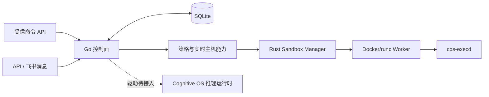

# super-agent-bot-plantform

[English](README.md) | **简体中文**

一个将持久化 Agent 身份与可销毁执行运行时分离的项目，基于 Go、Rust 和
C11 [Cognitive OS](https://github.com/LeonQin-ai/cognitive-os-agent) 构建。

Agent 身份、任务状态和记忆引用独立于执行进程保存，执行后端由任务策略与已验证的主机能力选择。
当前可用路径是在加固的 Docker/runc Worker 中运行经过批准的内部命令。
Firecracker、gVisor 和 WASM 各有独立的实现与验证里程碑。

**当前状态：** 已在真实 Linux 虚拟机上验证 Docker 执行链路。生产级 Cognitive OS
生命周期/消息驱动仍待接入，普通 API/飞书消息目前会以 `runtime_driver_unavailable` 失败。

## 已实现的能力

| 模块 | 当前行为 |
|---|---|
| 控制面 | Go HTTP API；SQLite 持久化 Agent、任务、收件箱和运行时记录 |
| 受信执行 | 同步及持久化队列命令；任务查询、幂等提交、运行中取消 |
| 恢复 | 启动 Worker 前记录其标识；重启清理已记录 Worker；中断任务失败且不自动重放 |
| 主机能力 | 鉴权探测；30 秒刷新、90 秒过期；SQLite 版本化记录；探测失败关闭执行准入 |
| Docker Worker | 预加载不可变镜像摘要/ID；非 root、根文件系统只读、无网络/额外能力、资源限制和私有工作区 |
| 飞书 | 签名校验、发送者白名单、私聊消息持久化后 ACK；真实推理尚未接通 |
| 生命周期 | 代次隔离和唤醒/休眠状态机；生产驱动尚未接线 |
| Firecracker / 文件代理 | Jailer、vsock、Guest RPC 和冲突校验提交基础；KVM 启动待验证 |
| gVisor / WASM | 策略和能力检测框架；执行 Provider 待实现 |

Go 调度器目前只接通 Docker 执行。策略选择了其他后端，并不表示该执行 Provider 已可用。
详细状态见[路线图](docs/roadmap.md)。

## 架构



- **Go 控制面**负责准入、持久状态、取消与恢复。
- **Rust `cos-sandboxd`** 是可信主机代理，管理 Worker 生命周期与能力探测。
  Agent 不会获得 Docker socket 或主机代理的 API token。
- **Rust `cos-execd`** 在 Worker 内执行结构化命令，提供截止时间、有界输出、seccomp 和资源限制。
- **Cognitive OS** 提供推理运行时基础，版本固定在
  [`COGNITIVE_OS_REF`](COGNITIVE_OS_REF)。直接容器容量测试与尚未完成的生产消息驱动是两项独立工作。

## 快速开始

### 启动控制面

需要 Go 1.23+。真实 Worker 执行还需要 Linux 主机上的 Sandbox Manager、Docker/runc
和 cgroup v2。Rust 构建已使用 Rust 1.99.1 验证。

```bash
git clone https://github.com/LeonQin-ai/super-agent-bot-plantform.git
cd super-agent-bot-plantform
go mod download
go run ./control/cmd/light-agentd
```

另开终端检查健康状态：

```bash
curl -fsS http://127.0.0.1:8080/healthz
```

默认监听 `127.0.0.1:8080`，状态保存在 `./data/light-agent.db`。
进程从环境变量读取配置，**不会自动加载 `.env`**。变量示例见 [`.env.example`](.env.example)。

对非回环地址开放 API 前需配置 `LIGHT_AGENT_API_TOKEN`。
`/v1/*` 请求使用 `Authorization: Bearer <token>`；健康检查和飞书 Webhook 有独立访问规则。

### 接通真实 Docker 执行

按照 [Docker Provider 指南](docs/docker-provider.md)构建并预加载不可变 Worker 镜像，
启动可信的主机 Sandbox Manager，再配置控制面：

```bash
export LIGHT_AGENT_API_TOKEN='<control-plane-secret>'
export LIGHT_AGENT_SANDBOX_MANAGER_URL='http://127.0.0.1:9090'
export LIGHT_AGENT_SANDBOX_MANAGER_TOKEN='<sandbox-manager-secret>'
go run ./control/cmd/light-agentd
```

两个服务应使用不同密钥。连接非回环地址的 Manager 必须使用 HTTPS；明文 HTTP 仅允许回环地址。

| 接口 | 用途 |
|---|---|
| `POST /v1/agents` | 创建持久化 supervisor 身份 |
| `POST /v1/agents/{id}/executions` | 提交受信结构化命令；必须提供 `request_id` 或 `Idempotency-Key` |
| `GET /v1/tasks/{id}` | 查询持久任务状态和结果 |
| `POST /v1/tasks/{id}/cancel` | 取消排队或运行中的任务 |
| `POST /v1/execution/run` | 同步执行短时受信命令 |
| `GET /v1/runtime/capabilities` | 查看当前主机能力和观测版本 |

请求示例和恢复语义见[持久化执行说明](docs/durable-execution.md)。
普通聊天文本不会直接转换为命令或镜像配置。Docker 路径接受受信内部任务；
后端不支持或不满足策略时拒绝执行。

### 用 Compose 部署控制面

```bash
cp deploy/.env.example deploy/.env
# 编辑 deploy/.env，替换示例密钥和配置。
docker compose --env-file deploy/.env -f deploy/compose.yaml up --build -d
```

Compose **仅部署 Go 控制面**，不会自动启动 Sandbox Manager、推理服务或模型。
API 端口发布在主机回环地址，不挂载 Docker socket。
容器化控制面需要可达、受保护的 HTTPS Manager 地址；容器回环地址并非 Docker 主机的回环地址。

## 实机验证与容量

在 **4 vCPU、3655MiB 内存**的 OpenCloudOS 虚拟机上，Go 竞态/静态检查、12 项 Rust
测试、release 构建和 7 组真实 Docker 冒烟检查均通过。
完整部署 Dockerfile 构建遇到基础镜像下载超时，冒烟测试使用了预加载测试基底。
详情见 [Linux 验证报告](docs/linux-validation-2026-11-06.md)。

[Agent 容量报告](docs/agent-capacity-2026-11-06.md)测量的是**真实、独立的 Cognitive OS
容器运行时，LLM 使用 Mock**：

| 负载 | 通过验证的实例数 | 持续检查 | 完成任务 / 错误 | P95 |
|---|---:|---:|---:|---:|
| 轻量推理，Mock LLM | 128 | 60 秒 | 15,360 / 0 | 181ms |
| 真实文件工具，Mock LLM | 64 | 120 秒 | 15,360 / 0 | 275ms |

扩容过程中曾有 154 个实例就绪，随后内存安全余量阻止继续扩容。这是启动记录，不是持续负载容量。
96 个文件工具实例未通过较长检查。针对本次负载，可从 64 个同时活跃实例开始，
再用实际任务组合和更长运行验证扩容；这些数据不能证明真实模型、编译/浏览器或 MicroVM 的容量。

```bash
# Linux 原生检查：需要 Go、Rust；竞态检测还需要 C 编译器。
bash scripts/validate-linux.sh
```

复测中，Linux 的 72 个文件工具实例通过了 120 秒负载验证，Windows 的两台 QEMU TCG 来宾通过了并发验证。 [Linux 与 Windows 容量复测报告](docs/agent-capacity-followup-2026-11-07.md)

真实执行复现脚本为 [`scripts/smoke-docker.py`](scripts/smoke-docker.py)，
容量测试见[复现指南](docs/agent-capacity-testing.md)。
CI 已配置 Go/Rust 检查、Worker 镜像构建和 Docker 生命周期冒烟测试。

## 安全边界

- 不提供通用主机 shell/exec API；执行失败时不回退到主机执行。
- 任务策略必须匹配可用后端，不静默降低隔离级别。Docker/runc 共享主机内核，用于经过批准的工作。
- Agent 容器仅获得分配的私有状态/工作区，无法访问主机 rootfs、Docker socket、
  Firecracker API socket 或 `/dev/kvm`。
- 镜像由运维预加载并固定为不可变引用；任务不能指定任意镜像、挂载或特权容器配置。
- 能力探测失败或过期会撤销准入；重启后不能使用历史快照恢复执行授权。
- 中断任务不会自动重放。分布式数据库所有权和事务化创建意图/孤儿 Worker 对账仍待实现。

生产部署前需验证目标主机上的实际后端与任务负载。
详见[安全边界](docs/security-boundaries.md)和[执行策略](docs/execution-policy.md)。

## 文档与代码

| 主题 | 文档 |
|---|---|
| 架构与里程碑 | [架构](docs/architecture.md) · [路线图](docs/roadmap.md) |
| 执行与部署 | [Docker](docs/docker-provider.md) · [持久任务](docs/durable-execution.md) · [后端选择](docs/runtime-backends.md) |
| 能力注册表 | [主机探测](docs/host-capability.md) · [刷新和历史](docs/capability-refresh.md) |
| 推理集成 | [Cognitive OS 契约](docs/cognitive-os-integration.md) |
| Firecracker | [Sandbox 部署](docs/sandbox-deployment.md) |
| 测量结果 | [Linux 验证](docs/linux-validation-2026-11-06.md) · [Agent 容量](docs/agent-capacity-2026-11-06.md) · [复现指南](docs/agent-capacity-testing.md) |

```text
control/       Go 控制面、策略、生命周期、API 和 SQLite 存储
rust/          主机 Sandbox Manager 与 Worker 内命令执行器
proto/         控制面 / Sandbox 协议契约
deploy/        控制面与 Worker 容器构建文件、Compose 配置
guest-image/   Firecracker Guest 安装脚本和 systemd 单元
scripts/       Linux 验证、Docker 冒烟和 Agent 容量测试
docs/          设计、部署、验证与待完成集成说明
```

许可证：[Apache-2.0](LICENSE)。
